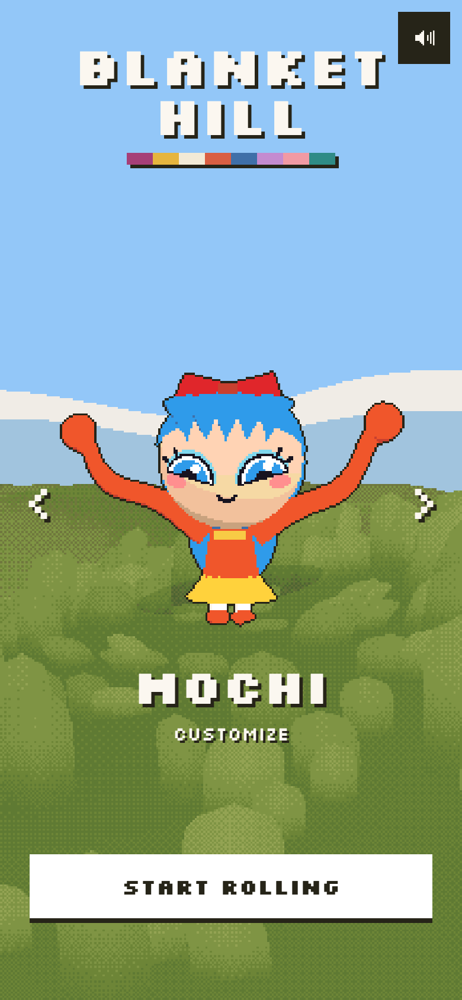
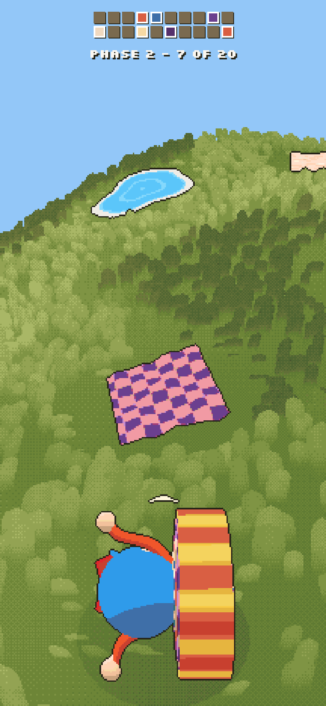
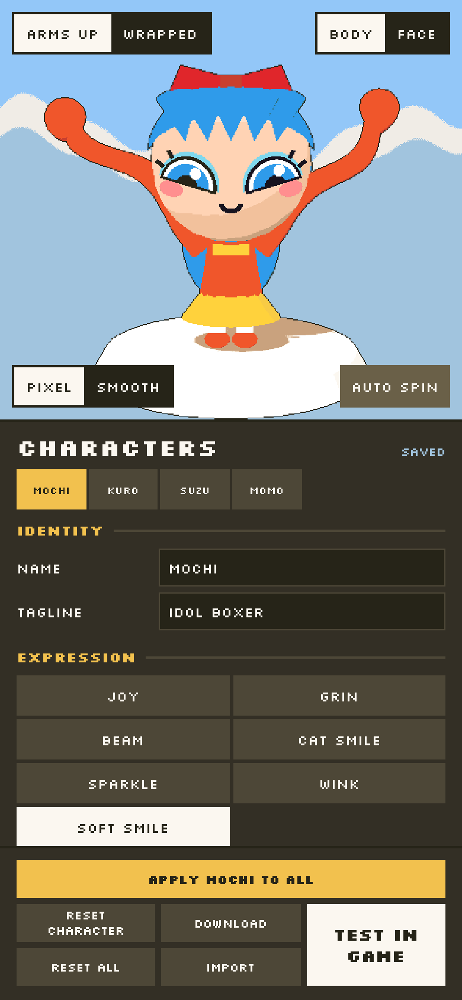

<p align="center">
  
  
  
</p>

# Blanket Hill

Roll around a steep green hill and wrap yourself in every scattered blanket. Clear phases of 10, 20, 40 and 60 blankets. Puddles knock your outer blanket back onto the hill.

## Play

Open `index.html` in a browser. It is one self-contained file and needs no server.

Drag on the screen or use the arrow keys or WASD to roll.

## Customize characters

Open `character-editor.html` to change each character's face, colors, proportions, wiggly arms and size. Edits save in your browser. Press **Test in game** to play with them.

Use **Download** to save your edits as `characterConfig.js`. To make them permanent, replace `src/characterConfig.js` with it and run the build.

## Develop

```sh
npm install
npm run build
```

The build bundles `src/blanket` into `index.html` and `src/editor` into `character-editor.html`. Run it after any source change.

Three.js and the Silkscreen font are included in `vendor/` with their licenses.
